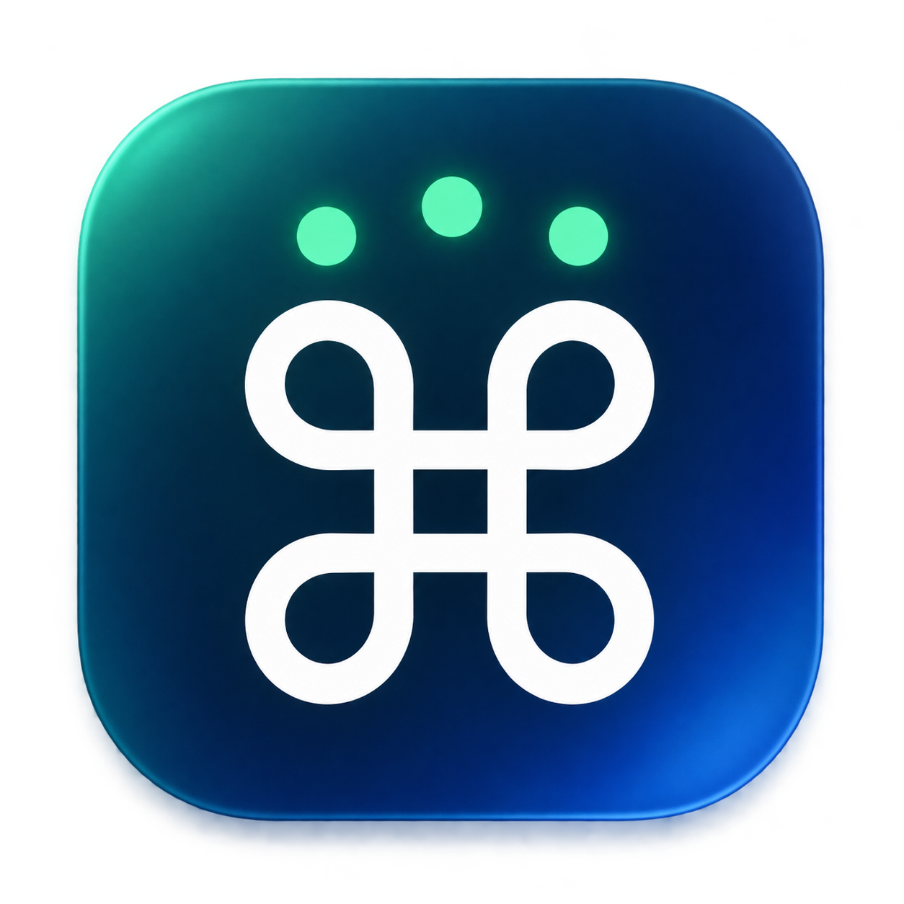

<p align="center"></p>

# TouchChord · 和弦

**让触摸成为快捷操作。Turn touch into shortcuts.**

[下载 v1.0.1](https://github.com/yy003x/touch-chord/releases/tag/v1.0.1) · [恢复说明](Docs/recovery.md)

v1.0.1 是当前使用基线。应用由 TriKey 更名为 TouchChord；内部 `local.trikey.app`、
固定签名、偏好键和 Swift 模块名称保留，避免仅因改名丢失权限或恢复标记。

原生 macOS 触控板修饰键工具：三指及以上接触时保持通用 Command（⌘），少于三指时释放。

包含 Swift 6 原生菜单栏应用、独立技术探针、单元测试及 DMG 打包脚本。
核心可行性及真实设备证据见 [Phase 1 报告](Docs/phase-1.md)。完整稳定性验收仍未完成，
不能据此宣称支持所有 macOS 版本。没有使用 Touchy 源码或第三方运行时。
固定签名、实际更新和界面检查结果见 [验证记录](Docs/verification.md)。

## 安装和使用

下载并打开 `TouchChord-1.0.1-arm64.dmg`，把 TouchChord 拖入 Applications，再从
`/Applications/TouchChord.app` 启动。更新前先退出旧版，不从挂载的 DMG 或 Build 目录长期运行。

本包使用固定的本地自签名证书，没有上架 App Store，也没有 Apple 公证。
若首次打开被拦截，先尝试打开，再在“系统设置 → 隐私与安全性”中为 TouchChord 点击“仍要打开”，
由本人确认。不需要关闭 Gatekeeper、SIP 或移除 quarantine 属性。
详见 [Apple 的打开应用说明](https://support.apple.com/zh-cn/102445)。

分别为 `/Applications/TouchChord.app` 开启辅助功能和输入监控。系统可能要求退出并重新打开应用；
这会使 TouchChord 设置窗口一起消失，重新打开应用会恢复未完成的授权设置。
返回 TouchChord 时会重新检查权限，也可手动点击“重新检查并连接”。
先抬起全部手指，再放三指，按 A / C / V 验证。少于三指立即释放，Escape 可紧急释放。

菜单提供启用、设置、登录启动、紧急释放、系统菜单栏设置和退出；设置中可调节防抖。
图标固定尺寸，平时显示 ⌘，模拟按住时反白，不显示 ON，不因状态改变挤动旁边的图标。
显示／隐藏统一由当前 macOS 的“系统设置 → 菜单栏 → 允许在菜单栏显示 → TouchChord”管理，
应用内不再维护另一套显示开关。隐藏后仍在后台运行；重新打开应用可进入设置，再通过
“系统菜单栏设置…”恢复图标。此系统开关流程已在当前 macOS 27.0.1 验证，旧系统未实测。
旧开发路径的登录项应从旧应用关闭后，在安装后的应用中重新开启。

## 固定签名

首次在开发机执行 `bash Scripts/setup-signing.sh`，按系统提示本人确认证书信任。
它生成有效期十年的 RSA 代码签名证书，私钥保存在当前用户的登录钥匙串，
仅为代码签名设置信任，不修改系统钥匙串或 SSL 信任。代码签名工具可能要求本人批准使用私钥。

证书和固定指纹记录保存在 `~/Library/Application Support/TriKey/Signing/`；
私钥不进入项目、应用或 DMG。不要删除钥匙串中的 `TriKey Local Development` 身份，
迁移开发机时应通过钥匙串安全导出证书及私钥，并保留 Signing 目录。

构建固定使用该指纹，应用身份要求绑定证书和 `local.trikey.app`，不会绑定每次变化的代码哈希。
缺少原身份时构建失败，禁止临时签名回退。普通更新仍重新签署文件，但保留相同应用身份。
证书更换、权限撤销、迁移设备或系统策略变化仍可能要求重新授权。
参见 [Apple 代码身份要求](https://developer.apple.com/documentation/technotes/tn3127-inside-code-signing-requirements)。

从旧临时签名迁移时，需要先退出旧 TriKey，再一次性清除仅此应用的旧记录：

```sh
tccutil reset Accessibility local.trikey.app
tccutil reset ListenEvent local.trikey.app
```

随后由本人给安装后的应用重新授权。**普通更新不要重复执行重置**。
重置不等于授权；不要操作 TCC 数据库，也不要清除其它应用的权限。

## 构建

当前设备：Apple Silicon，macOS 27.0.1，Xcode 27.0。声明的编译最低版本为 macOS 13，
并不表示该版本或 Intel Mac 已获实测支持。

```sh
bash Scripts/setup-signing.sh # 仅首次准备，已有身份时复用
bash Scripts/build.sh
bash Scripts/package-dmg.sh
DEVELOPER_DIR=/Applications/Xcode.app/Contents/Developer swift test
mkdir -p Artifacts
```

脚本仅在本次构建进程中选择已安装的 Xcode，不修改 `xcode-select` 全局配置，不安装依赖。
构建不覆盖运行中的 Build 应用；DMG 打包不覆盖已有同名产物。版本发布时更新
`Resources/Info.plist` 的版本号。构建后更新安装位置，再启动应用；构建脚本不会自动替换已安装版本。

## 探针

每次使用新的日志文件名；工具拒绝覆盖已有记录。

```sh
# 只读触摸：统计真实接触状态，忽略悬停和离开过渡状态。
.build/release/TriKeyProbe touch 120 Artifacts/touch-new.jsonl

# 只读物理 Command；不保存其它键盘输入或文字内容。
.build/release/TriKeyProbe keyboard 120 Artifacts/keyboard-new.jsonl

# 发送一次约 0.2 秒的 Command 按下和释放；执行期间不要输入文字。
.build/release/TriKeyProbe pulse-hid 1 Artifacts/pulse-new.jsonl

# 有时限的交互实验：会真实影响全局输入；先在自带文本区测试。
.build/release/TriKeyProbe hold 120 Artifacts/hold-new.jsonl
```

`hold` 使用 40 ms 激活防抖，少于三指立即释放；单次保持上限 30 秒，触摸数据中断超过
500 ms 时释放。超限后先把手指减少到两指或以下才能重新触发。按 `Escape` 紧急停止，
到达运行时限也会清理退出。这些是实验保护，不是正式产品的持续保持策略。

`pulse` 是另一条对照实验路径（private source + session 入口），本机实测未能维持系统状态，
保留用于复核，不作为后续方案。脉冲命令的时长参数仅遵循统一参数格式，实际脉冲固定约 0.2 秒。

## 权限

在“系统设置 → 隐私与安全性”查看：

- **辅助功能**：全局按键发送和修改输入事件。
- **输入监控**：读取物理 Command 的 HID 输入和只读事件监听。

命令行探针的授权身份可能归属于启动它的宿主。`.app` 的授权需单独验证，不能沿用
宿主授权测试结果。本人在系统设置中操作，程序不会修改 TCC 数据库、关闭 SIP 或绕过系统授权。

## 限制

`MultitouchSupport.framework` 是 Apple 私有框架，触点布局及符号没有稳定契约。
系统升级可能导致失败乃至进程崩溃；缺失必需符号或无法唯一识别内置设备时直接报错。
这条技术路径不符合 App Store 仅使用公开 API 的要求。

实验进程的清理、超时和事件过滤器都不能保证在 `SIGKILL`、进程崩溃、系统冻结或权限撤销后
仍执行。当前不得宣称“绝不会卡键”。如实验异常，先抬起触控板手指，再按下并松开真实 Command；
仍异常时检查实验进程是否退出。不要把探针配置为登录启动或用于无人监督的长期运行。

真实触控板上三指静止时再移动第四指，可能触发系统多指手势，不能保证产生普通鼠标移动或点击。
探针不修改用户的系统触控板手势设置。
